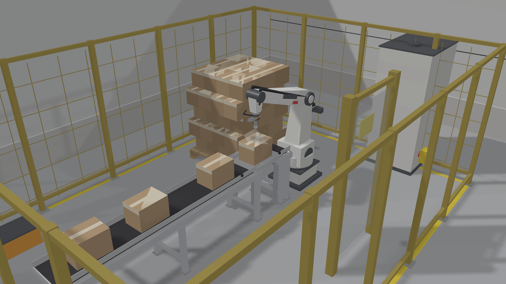
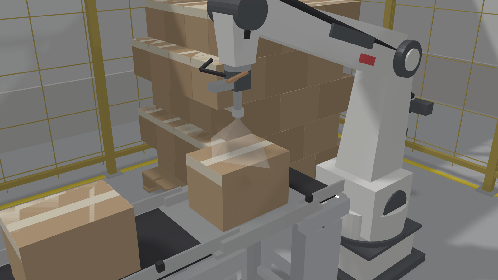
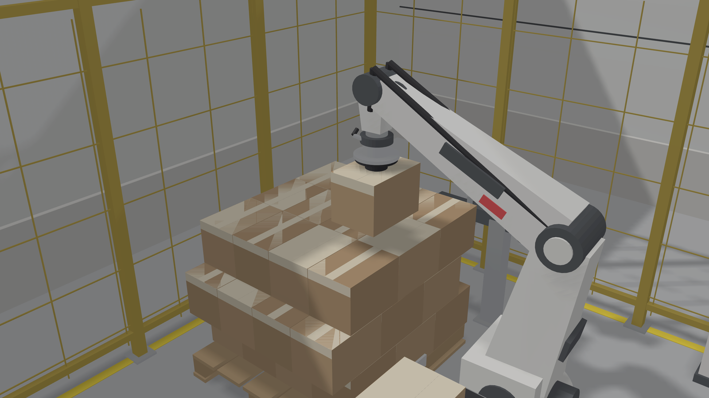
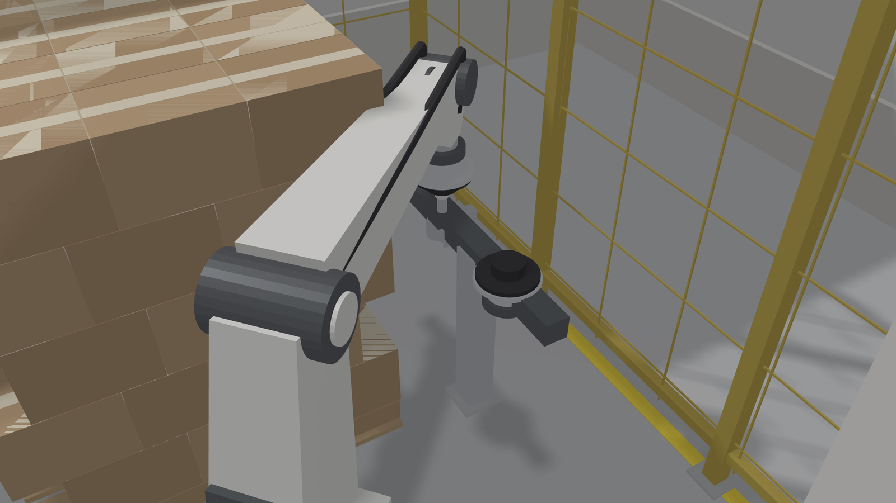
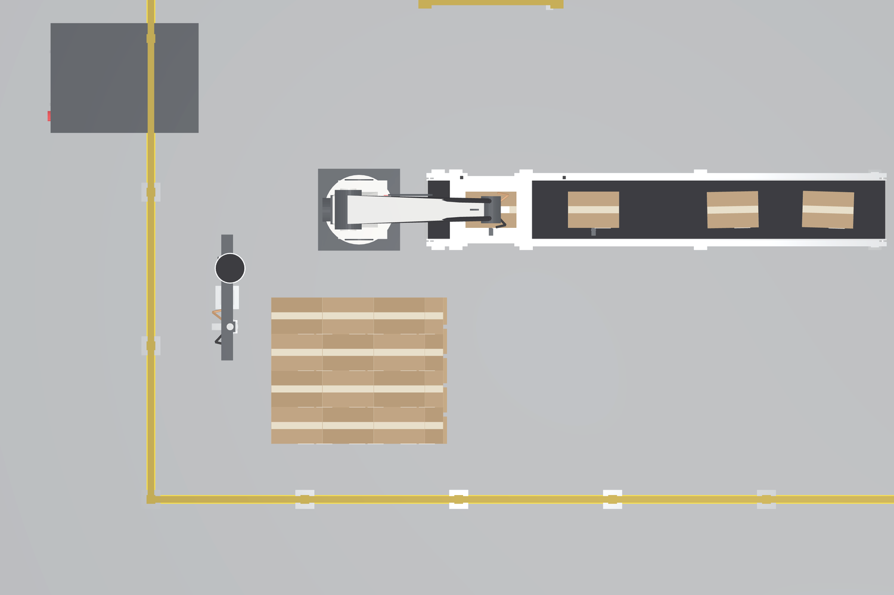
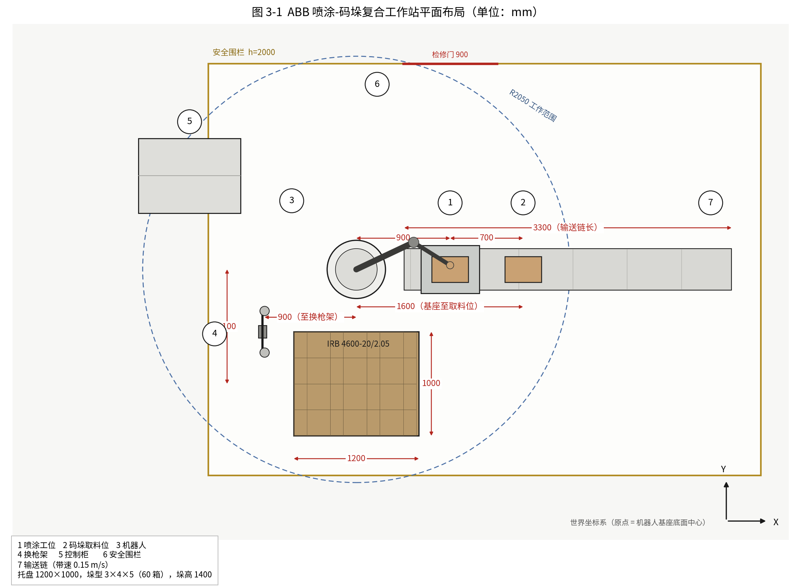

# 基于 RobotStudio 的 ABB 机器人喷涂与码垛复合工作站仿真设计

> 工业机器人专业毕业设计交付物：论文、RAPID 源程序、实操核对清单，以及一套**按论文参数在沙箱内三维重建并物理渲染**的工作站图与运动视频。

**重要声明：`工作站渲染/` 下的图片与视频不是 RobotStudio 仿真截图，也不是网图或实拍照片。** 它们是用 Python（trimesh + pyrender，EGL 离屏）按本论文的设备坐标、机器人公称几何、垛型参数从零建模渲染出来的三维示意图。几何关系与论文可逐条核对，但不含 Smart 组件面板、示教器界面与仿真时间轴。论文中引用时应标注为"三维结构示意图"。

---

## 目录结构

| 路径 | 内容 |
|---|---|
| `基于RobotStudio的ABB机器人喷涂与码垛复合工作站仿真设计.docx` | 论文正文：封面 + 中英文摘要 + 目录（52 条可跳转）+ 7 章 + 参考文献 + 致谢 + 附录 A/B/C，约 1.57 万字，24 张三线表 |
| `RAPID/MainModule.mod` | 主控模块，调度喷涂与码垛子程序、工具切换 |
| `RAPID/SprayModule.mod` | 喷涂模块，含 `SprayBatch` 批量换枪逻辑 |
| `RAPID/PalletModule.mod` | 码垛模块，`Offs()` 偏移 + 奇偶层错缝 |
| `仿真实操核对清单.md` | **交付前必读**：论文值与实测值的对照表、论文与源文件的 4 处差异、7 张必截图、答辩问答要点 |
| `工作站渲染/*.png` | 6 张渲染图（全景 / 喷涂 / 码垛 / 换枪 / 俯视 / 带尺寸布局图） |
| `工作站渲染/喷涂循环_7秒.mp4` | 106 帧，机器人从 Home 走完 `pTop1`→`pTop6` 三道锯齿轨迹，雾锥跟随喷枪 |
| `工作站渲染/源码/*.py` | 8 个建模与渲染脚本，改参数可重渲染 |

---

## 预览

### 工作站全景



### 喷涂工位



### 码垛工位



### 换枪站



### 俯视



### 平面布局图（带尺寸标注，可直接作为论文图 3-1）



### 运动视频

[喷涂循环_7秒.mp4](工作站渲染/喷涂循环_7秒.mp4)（3.2 MB，15 fps，1280×720）

---

## 关键设计参数

| 项目 | 取值 | 依据 |
|---|---|---|
| 机器人 | IRB 4600-20/2.05 | 末端负载 11 kg × 1.3 动载系数 = 14.3 kg；托盘最远角水平距离 1709 mm，均落在 20 kg / 2050 mm 之内 |
| 臂展几何 | 2050 mm（L1 = 780，L2 = 1020） | ABB 公称数据，用于建模与可达性校核 |
| 纸箱 | 350 × 250 × 200 mm，约 3.5 kg | 自定义工况 |
| 托盘 | 1200 × 1000 mm | 标准托盘 |
| 垛型 | 3 × 4 × 5 = 60 箱，垛高 1400 mm | 奇数层与偶数层错缝 |
| 输送链 | 长 3300 mm，带速 0.15 m/s，台面高 700 mm | — |
| 喷涂工位 | 距基座 900 mm（X 向） | 顶面六点锯齿轨迹 |
| 码垛取料位 | 距基座 1600 mm（X 向） | — |
| 换枪架 | 距基座 900 mm（−X 向） | 喷枪 / 真空夹爪双工位 |
| 节拍 | 逐件换枪 32.5 s → 111 件/h（不达标）；6 件一批换枪 24.2 s → 149 件/h（达标） | 论文第 6 章 |

> 以上坐标与节拍均为**按几何关系推算**，不是从实际 RobotStudio 工作站读出的。核对清单第四节提供了"论文值 → 实测值"的改写表格，实测后需同步修正论文表 4-3、表 5-1、表 6-2。

---

## 渲染是怎么做的

不是贴图拼接，是真正建了几何体再打光渲染：

1. **机器人**：按 IRB 4600 的连杆长度建六轴运动链，自写正解与解析逆解（`robot.py`），关节旋转在 trimesh 层做变换后合并，避免 pyrender 无法变换 Mesh 的问题。
2. **场景**：按论文表 3-3 的七个设备坐标布置输送链、喷涂工位台、托盘、换枪架、控制柜、围栏、车间围墙（`station.py`）。
3. **光照**：主光 + 补光 + 轮廓光 + 顶光四盏平行光，PBR 材质，2× 超采样后下采样抗锯齿（`engine.py`）。
4. **视频**：沿喷涂示教点做关节空间插值，逐帧渲染再 ffmpeg 编码（`video.py`）。
5. **布局图**：matplotlib 绘制，含尺寸标注、编号、图例（`layout.py`）。

复现：

```bash
pip3 install pyrender trimesh PyOpenGL numpy matplotlib pillow
cd 工作站渲染/源码
PYOPENGL_PLATFORM=egl python3 shots.py    # 5 张渲染图
PYOPENGL_PLATFORM=egl python3 video.py    # 106 帧 → 自行 ffmpeg 合成
python3 layout.py                          # 布局图
```

依赖 EGL 离屏渲染（无显卡亦可，走软件光栅）。修改 `robot.CARTON`、`station.PALLET` 等常量即可调整工况后重渲染。

---

## 建模过程中发现的三处论文隐患

这三条比图片本身更值得在答辩前处理：

1. **第 5 层最远角贴着臂展极限。** 论文按水平距离 1709 mm 校核（< 2050），但码到第 5 层时箱顶 z = 1400，法兰升至 1580，相对 J2 的三维距离为 **2047 mm**，仅余 3 mm。真机示教大概率报不可达。建议托盘向基座移 100～150 mm，或降为 4 层。
2. **错缝 125 mm 的文字解释自相矛盾。** 论文称"沿 X 向偏移 125 mm，即纸箱宽度的一半"，但 X 向对应箱长 350，宽度 250 在 Y 向；半长错缝应为 175 mm。且单向累加 5 层后垛体明显偏向一侧，渲染图上一眼可见倾斜趋势。建议改为 ±62.5 mm 双向对称，或采用 175 mm 半长错缝。
3. **输送链与机器人基座共线冲突。** 3300 mm 输送链、喷涂工位（900）、取料位（1600）均在 Y = 0 线上，而基座位于 (0, 0)、半径 280 mm，三者共线必然相交。本仓库的模型处理为"输送链分段 + 喷涂工位独立顶升台"，论文 3.4 节未交代该处理，补写为宜。

---

## 渲染的局限

- 材质为程序化纯色 PBR，无 UV 贴图，纸箱与墙面偏"干净"，非照片级。
- 隔爆要求（真机喷涂必须用 IRB 52 / IRB 5500 防爆型）在模型中无体现，论文 3.1.3 节已作文字说明。
- 背向机器人的两个纸箱侧面喷不到，模型中同样未表现，与论文 6.6.1 的局限说明一致。

---

## 使用注意

- 论文与 `RAPID/*.mod` 有 4 处差异（`\WObj` 显式指定、`<>` 改 `= 0`、`SprayBatch` 等待位置、换枪点定义），原因见核对清单第二节。老师对照论文问代码时按该表回答。
- 参考文献 10 条均为可查证的经典著作、国家标准与 ABB 官方手册，未编造期刊卷期号；多数院校要求 15 条以上含近五年文献，需自行在知网补充 5～8 条。
- 仓库默认 private，避免论文公开后被查重系统收录。确认答辩结束后再决定是否转公开。
